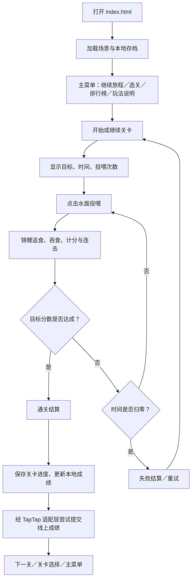

# 碧池拾光：H5 横屏小游戏设计文档

- 文档版本：0.3（鱼类图谱、30 种花色与稀有度解锁）
- 项目类型：H5 横屏轻竞技／养成小游戏
- 游戏入口：项目根目录 `index.html`（跳转至 `code/index.html`）
- 代码目录：`code/`
- 文档目录：`doc/`
- 素材资源目录：`assets/`，存放游戏美术素材、生成提示词和资源规格记录。
- 视觉参考：用户提供的锦鲤池塘壁纸截图
- 设计参考：用户提供的《fishwallpaper-项目导读与初版设计文档.md》

## 1. 产品概述

### 1.1 游戏定位

**《碧池拾光》** 是一款以俯视锦鲤池塘为舞台的横屏 H5 轻竞技游戏。玩家通过点击或触摸水面投放鱼食，吸引锦鲤聚拢、追食并触发连击，在限定时间内达到本关目标分数，逐步解锁后续关卡。

游戏保留参考项目最有辨识度的氛围：池水、荷叶、荷花、锦鲤、蝴蝶、柔和水光与低压力的自然节奏；在此基础上新增关卡、目标分数、时间限制、投喂次数、通关结算、进度存档和排行榜入口。

### 1.2 设计目标

1. **一眼可懂**：进入游戏后，玩家能看懂“点水面投喂—锦鲤追食—获得分数—达成目标”的核心循环。
2. **短局可玩**：单关约 1 分钟，适合 H5 的碎片化体验。
3. **轻操作有反馈**：每次投喂都有水波、鱼群转向、得分跳字／粒子与轻音效。
4. **持续推进**：关卡逐步提高目标分数和节奏要求，解锁状态保存在本机。
5. **服务端能力可替换**：线上排行榜、云端存档等服务端功能集中经 `taptap.minigam.mcp` 适配层接入，不把服务调用散落在玩法代码里。

### 1.3 参考边界

参考文档描述的原项目是一个原生 JavaScript 与 WebGL2／Canvas 结合的锦鲤池塘动态壁纸，包含鱼群仿真、投喂、天气与环境声，并以本地存储保存部分养成数据。它**不是**一款现成的关卡游戏，也没有仓库内建的账号、线上排行榜或云存档后端。

因此，本设计仅借鉴其池塘氛围、锦鲤行为、投喂反馈、轻依赖网页架构和本地存档思路。关卡规则、分数体系、游戏 UI 与排行榜属于本项目新增设计。参考仓库文档提示未发现 LICENSE，正式复用其源码或美术资源前应先确认授权。游戏代码独立编写；早期原型使用截图裁切底图，v0.2 改用依据用户提示词生成的无动物池塘背景，图片和完整生成记录统一存放在根目录 `assets/`。

## 2. 核心玩法

### 2.1 核心循环

1. 进入关卡，查看目标分数、剩余时间和可投喂次数。
2. 在池塘水面点击／触摸一个位置，投放一团鱼食。
3. 附近锦鲤改变游动方向，向鱼食聚拢。
4. 锦鲤抵达鱼食后触发吞食，增加分数与连击；连击越高，单次吞食得分越高。
5. 玩家观察鱼群位置，选择下一次投喂点，争取让更多锦鲤快速聚集。
6. 达到目标分数即通关；时间归零且未达标则失败，可重试本关。
7. 通关后解锁下一关，保存进度，并把本次成绩提交给排行榜适配层。

### 2.2 主要规则

| 规则 | 设计 |
|---|---|
| 目标 | 在倒计时结束前达到关卡目标分数 |
| 投喂 | 点击／触摸水面投放鱼食；每关有固定投喂次数 |
| 鱼食 | 每团鱼食包含若干可被锦鲤消耗的食粒；食粒耗尽或存在时间过长后消失 |
| 得分 | 每次吞食获得基础分；连击和关卡等级提供少量加成 |
| 连击 | 连续吞食之间的间隔较短时，连击递增；间隔过长则重置 |
| 通关 | 分数达到目标后立即结算并解锁下一关 |
| 失败 | 倒计时结束仍未达标；不扣除已解锁关卡，可直接重试 |
| 进度 | 保存当前关卡、最高解锁关卡、累计旅程分数和各关最佳分数 |
| 暂停 | 暂停时停止倒计时、鱼食消耗与关卡仿真；界面保留继续、重开和返回菜单选项 |

### 2.3 分数公式（初版）

单次吞食得分采用简单、可调的公式：

`得分 = 12 + min(当前连击数, 5) × 2 + floor(关卡编号 / 2)`

- 基础得分为 12。
- 连击加成最多计到 5 档，避免无限膨胀。
- 高关卡提供小幅额外加成。
- 每关目标分数和投喂次数由关卡配置统一管理，后续可根据实际测试调整。

### 2.4 反馈与策略

- **投喂位置**：靠近鱼群可快速得分；投到鱼群较远处，需要更长时间聚拢。
- **投喂节奏**：连续投喂有助于持续吸引鱼群，但次数有限，不宜随意浪费。
- **连击观察**：鱼群密集吞食时连击提升，适合在鱼群聚集处继续投喂。
- **关卡挑战**：后续关卡提高目标分数、鱼群移动速度或减少时间，鼓励玩家优化投喂位置与时机。

## 3. 游戏流程

### 3.1 总流程



### 3.2 首次启动

1. 初始化画布、池塘底图与锦鲤。
2. 从 `localStorage` 读取并校验存档；损坏或不存在时创建默认存档。
3. 如果运行环境注册了 TapTap 服务提供器，则经适配层请求云端存档；云端不可用时继续使用本地存档。
4. 显示主菜单。默认解锁第 1 关，提供“继续旅程”“选择关卡”“排行榜”“玩法说明”。

### 3.3 关卡中

- 顶部显示关卡名、当前分数、倒计时、音效开关和暂停按钮。
- 左下角显示目标分数进度与剩余投喂次数。
- 玩家点击可交互的池塘区域投喂；点击 UI 不应误触发投喂。
- 达到目标分数立即进入通关结算；时间归零进入失败结算。
- 玩家可随时暂停，暂停不扣除剩余时间。

### 3.4 结算与继续

- 通关结算显示本关分数、目标完成情况、连击提示和下一关按钮。
- 更新 `maxUnlockedLevel` 与当前待继续关卡；保存每关最佳分数。
- 将本次旅程分数与通关关卡传给 TapTap 适配层提交；如果未连接线上服务，则明确显示“线上排行榜未连接”，不伪造成功。
- 失败结算提供“重试本关”和“返回主菜单”，不回退最高解锁关卡。

## 4. 游戏操作方式

### 4.1 鼠标／触控

| 操作 | 结果 |
|---|---|
| 鼠标左键点击水面 | 在点击位置投放一团鱼食 |
| 手指轻触水面 | 与鼠标点击相同 |
| 点击“暂停” | 暂停当前关卡 |
| 点击“音效” | 开／关程序合成音效 |
| 点击“排行榜” | 打开排行榜面板 |
| 点击“选关” | 打开关卡选择面板；未解锁关卡不可进入 |
| 点击“继续旅程” | 从存档记录的关卡重新开始本关，并保留已保存的旅程进度 |

### 4.2 键盘

- `Esc`：游戏进行中打开暂停面板；暂停时可恢复。
- `Space`：暂停／恢复。
- `Enter`：在主菜单或结算面板中激活默认主按钮（具体焦点由浏览器决定）。

### 4.3 横屏与触控区域

- 目标画面比例为 16:9，推荐 1280×720 及以上。
- 桌面端以鼠标点击为主；移动端以单指点击为主，不要求拖拽或多指手势。
- 竖屏时显示“请横屏体验”提示；不强制调用可能不受浏览器支持的屏幕方向锁定 API。
- 所有 UI 点击区域应有足够间距，避免误触池塘投喂。

## 5. 界面设计

### 5.1 视觉方向

- **主视觉**：水绿、青苔绿、暖金与荷花粉；池塘场景占据屏幕主要面积。
- **面板**：半透明深青玻璃感面板，柔和边框、圆角与轻微背景模糊；保证文字对比度。
- **字体**：优先使用系统无衬线字体；分数与时间采用较粗字重。
- **动效**：轻量、短时、不遮挡操作。避免高频闪烁和过多弹窗。
- **信息层级**：游戏目标和倒计时优先级最高；排行榜、帮助等次级操作放在角落或菜单中。

### 5.2 主游戏 HUD 布局

以 1600×900 逻辑参考画布描述，实际按屏幕比例缩放：

| 区域 | 位置 | 内容 | 交互 |
|---|---|---|---|
| 品牌区 | 左上 | 荷花符号、游戏名“碧池拾光”、当前关卡名 | 无 |
| 关卡状态区 | 顶部偏左／中 | 第几关、目标提示 | 无 |
| 计分区 | 右上 | 本关得分、剩余时间 | 无 |
| 系统操作区 | 右上角 | 音效开关、暂停 | 可点击 |
| 目标面板 | 左下 | 目标分数、进度条、剩余投喂次数 | 无 |
| 操作提示 | 底部中间 | “点击水面投喂，吸引锦鲤追食” | 无 |
| 快捷操作 | 右下 | 排行榜、选关／帮助入口 | 可点击 |
| 池塘场景 | 全屏底层 | 水面、荷叶、锦鲤与水波特效 | 除 UI 外可点击投喂 |

### 5.3 主菜单

- 背景继续展示动态池塘，叠加柔和暗色渐层。
- 主标题：“碧池拾光”；副标题：“一池锦鲤，一场拾光之旅”。
- 主按钮：“继续第 N 关”。
- 独立收藏入口：“鱼类图谱”，显示已解锁数量／30。
- 次按钮：“选择关卡”“排行榜”“玩法说明”。
- 菜单底部提示：当前存档为本机存档；如果云端未接入，不能暗示跨设备同步。

### 5.4 关卡选择面板

- 采用 3×4 网格展示 12 个关卡。
- 已解锁关卡可点击；未解锁关卡使用锁图标与低亮度显示。
- 每个关卡卡片显示编号、主题名与该关最佳分数（若存在）。
- 重新挑战已解锁关卡允许游玩，但不应降低 `maxUnlockedLevel`。

### 5.5 暂停面板

包含“继续游戏”“重新开始本关”“返回主菜单”三个按钮。暂停期间倒计时和鱼群仿真冻结；返回菜单前自动保存已确认的进度数据。

### 5.6 通关／失败面板

**通关：**
- 标题“本关达成”。
- 显示本关得分、目标分数、旅程累计分数。
- 主按钮“下一关”；末关显示“旅程完成”。
- 次按钮“再玩一次”“返回主菜单”。

**失败：**
- 标题“再试一次”。
- 显示当前分数与目标差距。
- 主按钮“重试本关”。
- 次按钮“返回主菜单”。

### 5.7 排行榜面板

- 标题“池塘排行榜”。
- 线上区域展示 TapTap 服务返回的排行榜数据；未接入时显示明确的离线提示。
- 本地成绩区展示本设备保存的成绩，排序规则为旅程总分降序，其次按通关关卡降序。
- 显示昵称、旅程分数、最高通关关卡和记录时间。
- 本地榜仅用于原型验证，不等同于全球／跨设备排行榜。

### 5.8 玩法说明面板

简短展示三步说明：点击水面投喂、锦鲤追食得分、时间结束前达到目标。补充提示投喂次数有限，鱼群靠近时连续吞食可以形成连击。

### 5.9 鱼类图谱

- 主菜单设置独立「鱼类图谱」入口，展示已解锁数量与总计 30 种花色。
- 图谱支持稀有度筛选、仅看已解锁、花色缩略图与详细预览；显示名称、鱼体类型、体型、花色描述和通关解锁条件。
- 未解锁花色使用暗色预览，仍可查看解锁目标；筛选为空时提供说明。
- 四类鱼体轮廓为锦鲤、流线鲤、圆身鲤、长鳍蝶鲤，搭配大中小体型、色块、丹顶、网鳞、横带、花瓣、星斑等纹样。名称属于艺术设计，不代表生物分类。
- 通关结算展示本次新增的两种花色，可打开图谱后返回结算；重复通关不重复发放。
- 初始开放 6 种，每通关一关新增 2 种，第 12 关通关后集齐 30 种。完整清单见 `doc/鱼类图谱.md`。

| 稀有度 | 解锁阶段 | 数量 |
|---|---|---:|
| 寻常 | 初始 6 种，通关第 1–2 关各 2 种 | 10 |
| 雅品 | 通关第 3–5 关，每关 2 种 | 6 |
| 珍稀 | 通关第 6–8 关，每关 2 种 | 6 |
| 绝品 | 通关第 9–10 关，每关 2 种 | 4 |
| 传说 | 通关第 11–12 关，每关 2 种 | 4 |

池塘鱼群只使用已解锁花色，开始关卡和返回主菜单时更新；优先显示最新解锁的两种，再混合抽取其余花色，尽量减少重复。重玩早期关卡也保留全部已解锁候选。稀有度与体型仅改变外观，不增加分数或吞食范围。

图谱进度从已有存档推导，无需重置存档或增加重复字段：第 1–11 关奖励依据最高解锁关卡，第 12 关奖励额外要求该关最佳分数达到目标。旧存档自动获得对应花色，刷新和失败不回退。

## 6. 关卡设计

### 6.1 关卡结构

首版规划 12 关，采用统一核心机制与递进参数，减少初版开发成本。每关均为限时挑战，目标分数、时间、投喂次数和鱼群规模由一个关卡配置函数计算。

### 6.2 关卡表

| 关卡 | 主题名 | 目标分数 | 时间 | 投喂次数 | 设计重点 |
|---:|---|---:|---:|---:|---|
| 1 | 初见荷塘 | 100 | 60 秒 | 7 | 教会玩家点击投喂与观察鱼群 |
| 2 | 晨光微漾 | 160 | 60 秒 | 7 | 鼓励靠近鱼群投喂 |
| 3 | 双鲤逐光 | 220 | 58 秒 | 7 | 引入连击意识 |
| 4 | 荷影回廊 | 280 | 58 秒 | 8 | 提高目标并略增鱼群速度 |
| 5 | 金鳞浅滩 | 340 | 56 秒 | 8 | 要求更合理分配投喂次数 |
| 6 | 花雨池心 | 400 | 56 秒 | 8 | 鱼群移动更活跃，奖励节奏更紧凑 |
| 7 | 青叶深处 | 460 | 54 秒 | 9 | 强调多次有效投喂 |
| 8 | 锦影成群 | 520 | 54 秒 | 9 | 目标较高，要求维持连击 |
| 9 | 月色清池 | 580 | 52 秒 | 9 | 倒计时压力提升 |
| 10 | 流光回旋 | 640 | 52 秒 | 10 | 综合考验投喂位置和节奏 |
| 11 | 百鳞竞游 | 700 | 50 秒 | 10 | 高目标、较快鱼群 |
| 12 | 碧池拾光 | 760 | 50 秒 | 10 | 首版终章，综合挑战 |

> 上表是首版设计值；原型运行后，应通过试玩数据校准目标分数、每团鱼食数量和鱼群速度，避免关卡过易或无法达成。

### 6.3 参数与解锁规则

- 关卡目标分数：首版按每关增加约 60 分递进。
- 倒计时：每两关减少约 2 秒，最低不低于 50 秒。
- 投喂次数：每三关增加 1 次。
- 鱼群规模：随关卡逐渐增加并设置上限，避免低端设备过载。
- 鱼食团包含的可消耗食粒：随关卡缓慢增加，确保难度增长不会完全依赖刷高目标分数。
- 达成目标立即通关；未达标且时间归零则失败。
- 通过第 N 关后解锁第 N+1 关；第 12 关完成后显示终章结算。
- 允许重玩已解锁关卡；重玩成绩可刷新该关最佳分数，但不能锁回后续关卡。

## 7. 特效设计

| 触发 | 特效 | 时长／约束 | 目的 |
|---|---|---|---|
| 点击投喂 | 点击位置扩散 2–3 圈水波，出现小颗粒鱼食 | 约 0.5–0.8 秒 | 明确反馈点击位置 |
| 锦鲤追食 | 鱼头朝向食物，游动轨迹略微收拢 | 平滑转向，避免瞬移 | 强化“我在引导鱼群”的感受 |
| 吞食 | 小水花、金色粒子与分数提示 | 约 0.6 秒 | 让得分事件清晰可见 |
| 连击 | 连击数轻微放大，颜色由浅金加深 | 不使用强闪烁 | 形成节奏奖励 |
| 通关 | 柔和金色涟漪、荷花色粒子向外散开 | 约 1.2 秒 | 传达完成感 |
| 失败 | 场景轻微压暗，水波渐停 | 约 0.5 秒 | 平缓切换到结算 |
| 按钮悬停／按下 | 轻微上浮、亮度变化 | 0.12–0.18 秒 | 提示可交互性 |

特效以 Canvas 2D 绘制，不要求第三方渲染框架。粒子数量需设上限，页面隐藏时暂停主要动画，避免长时间后台运行带来不必要的性能消耗。

## 8. 音效设计

首版使用 Web Audio API 程序合成音效，不依赖外部音频文件：

| 事件 | 声音方向 | 设计约束 |
|---|---|---|
| 投喂 | 短促、柔和的水滴／木鱼式双音 | 音量低，避免每次点击刺耳 |
| 吞食 | 清脆轻点音 | 与得分事件同步 |
| 连击 | 比普通吞食略高的音高 | 不随连击无限变响 |
| 通关 | 三音上行、带轻微余韵 | 约 0.8–1.2 秒 |
| 失败 | 低音短提示 | 不使用惊吓音 |
| 环境氛围 | 可选轻柔水声底噪 | 后续迭代；首版不默认持续播放 |

- 音效默认关闭，玩家首次点击后可主动开启，避免浏览器自动播放限制。
- 音效开关写入本地设置。
- 页面暂停、失焦或离开游戏时，应降低或停止不必要的声音调度。
- 后续如添加真实环境音素材，应确认来源授权与文件体积。

## 9. 存档设计

### 9.1 存档字段

本地存档 Key：`bichi-shiguang-save-v1`。

```json
{
  "schemaVersion": 1,
  "currentLevel": 1,
  "maxUnlockedLevel": 1,
  "runScore": 0,
  "bestCampaignScore": 0,
  "bestScores": {},
  "nickname": "池塘旅人",
  "settings": { "soundOn": false },
  "localRanking": [],
  "updatedAt": 0
}
```

### 9.2 保存时机

- 首次初始化后创建默认存档。
- 开始／继续关卡时记录当前关卡。
- 通关时更新当前待继续关卡、最高解锁关卡、旅程累计分数、每关最佳分数。
- 失败时保存当前关卡，不回退解锁进度。
- 修改昵称或音效设置时立即保存。
- 页面进入隐藏状态或即将离开时尝试做一次轻量保存。

### 9.3 恢复与异常

- 读取后必须校验关卡范围（1–12）、分数类型、设置类型与榜单结构。
- JSON 损坏时回退到默认存档，不阻止玩家进入游戏。
- `localStorage` 不可用或容量异常时，提示“本机存档不可用”，游戏仍可继续，但不能承诺刷新后保留进度。
- 当前原型记录关卡进度和旅程分数，不保存每一帧鱼的位置、剩余秒数或当前投喂动画；重新进入时从存档关卡重新开始该关。
- 本地存档只属于当前浏览器存储分区；不同浏览器、域名、端口或 `file://` 来源之间不保证共享。

### 9.4 云端存档

云端存档必须通过 `code/js/taptap-adapter.js` 的统一接口调用。当前执行环境未提供可直接调用的 `taptap.minigam.mcp` 工具定义，因此原型不会虚构官方方法名、接口地址或“同步成功”结果。接入时应由实际 MCP 工具／SDK 提供器注册实现，再验证账号身份、存档字段、冲突规则、错误码与隐私要求。

## 10. 排行榜设计与 TapTap 接入

### 10.1 排行规则

- 排序字段：旅程累计分数降序。
- 同分时：最高通关关卡降序。
- 再同分时：记录时间较早者优先。
- 上报字段建议：用户标识（由平台能力提供）、展示昵称、旅程分数、最高通关关卡、版本号与时间戳。
- 服务端应校验分数与关卡合法性；客户端分数不能视为可信的反作弊凭证。

### 10.2 数据展示

- **线上榜**：只在实际服务返回成功且数据结构通过校验后显示。
- **本地榜**：将当前设备的最近成绩存储在本地，最多保留 20 条，用于离线体验和 UI 验证。
- **离线状态**：明确标注“线上排行榜未连接；以下为本机记录”。不得把本地榜伪装成全服榜。
- 提交失败时保留本地成绩，并给出可理解的状态提示；不要因排行榜失败阻止通关或保存进度。

### 10.3 适配层边界

`TapTapAdapter` 是项目内部的适配接口，不代表 TapTap 官方 API 的确切命名。需要实际 MCP 能力后，再将其绑定到真实的工具调用。项目约定的内部操作为：

- `loadProgress()`：请求云端进度（若平台支持）。
- `saveProgress(save)`：保存进度（若平台支持）。
- `getLeaderboard()`：读取线上榜单。
- `submitScore(record)`：提交成绩。

这些操作的参数与返回值是**本项目内部契约**；正式接入前须依据实际 `taptap.minigam.mcp` 工具 schema 对齐，不得直接假定它们就是官方函数名。

当前状态：
- 本地存档：已实现。
- 本地榜单：已实现，用于原型与离线体验。
- TapTap 在线排行榜、云存档：适配入口已留，等待可用 MCP／SDK 接口接入与联调。
- 当前环境没有检索到名为 `taptap.minigam.mcp` 的可调用工具；因此不能声称线上提交、云同步已完成。

## 11. 技术架构与目录

### 11.1 技术选型

- HTML5 + CSS3 + 原生 JavaScript。
- Canvas 2D 绘制动态锦鲤、水波、鱼食与粒子。
- CSS 背景引用根目录 `assets/backgrounds/` 中的纯池塘场景；背景不含动物、文字和 UI，动态游鱼由 Canvas 单独绘制。
- `localStorage` 保存本地进度、设置与本地榜单。
- TapTap 服务端能力统一经 `TapTapAdapter` 接口，具体实现由实际 MCP／SDK 提供器注入。
- 不引入 React/Vue 或第三方 npm 依赖，方便快速部署到静态 H5 环境。

### 11.2 目录结构

```text
bichi-shiguang-h5/
├── index.html                       # 根入口，跳转到 code/index.html
├── README.md                        # 运行说明与当前接入状态
├── assets/                          # 游戏美术素材与生成提示词
│   ├── README.md                    # 素材索引、规格与使用规范
│   ├── backgrounds/
│   │   └── pond-jade-v1.png          # 新版浅玉色池塘背景原图
│   ├── icons/
│   │   └── lotus.svg                # 页面荷花图标
│   └── prompts/
│       └── pond-jade-v1.md           # 原始提示词、修订提示词与检查记录
├── doc/
│   └── 碧池拾光_H5小游戏设计文档.md
└── code/
    ├── index.html                   # 游戏主页面
    ├── css/
    │   ├── game.css                 # 横屏布局、HUD、弹窗与响应式样式
    │   └── atlas.css                # 鱼类图谱、筛选、预览与解锁奖励
    └── js/
        ├── levels.js                # 十二关参数配置
        ├── fish-catalog.js          # 30 种花色、稀有度和通关解锁
        ├── fish-art.js              # 池塘与图谱共用鱼体绘制
        ├── engine.js                # 玩法规则、鱼群仿真
        ├── renderer.js              # Canvas 锦鲤、水波与粒子绘制
        ├── game.js                  # 主循环、锦鲤行为、关卡与 UI
        ├── storage.js               # 本地存档、进度校验、本地榜单
        └── taptap-adapter.js        # 所有服务端能力的唯一适配入口
```

### 11.3 模块职责

| 模块 | 职责 |
|---|---|
| `game.js` | 运行状态、关卡配置、鱼群更新、鱼食、得分、时间、UI 交互和结算 |
| `storage.js` | 默认存档、字段校验、本地读写、本地榜单和成绩记录 |
| `taptap-adapter.js` | 统一处理云存档和线上榜单；没有提供器时返回明确的未连接状态 |
| `game.css` | 背景、玻璃面板、横屏布局、弹窗、触控适配与动效 |
| `assets/backgrounds/pond-jade-v1.png` | 新版纯池塘场景底图，不承载玩法逻辑，不烘焙游鱼 |
| `assets/prompts/pond-jade-v1.md` | 对应素材的原始提示词、修订提示词、目标规格与实际输出记录 |

### 11.4 运行方式

推荐在项目根目录运行一个静态 HTTP 服务：

```bash
python -m http.server 8000
```

浏览器访问 `http://localhost:8000/`。也可直接打开根 `index.html`，但部分浏览器在 `file://` 下的存储行为可能不同。部署到线上时，应发布根入口 `index.html`、`code/` 和根目录 `assets/`，保持相对路径不变；`code/css/game.css` 使用 `../../assets/backgrounds/pond-jade-v1.png` 加载背景。

### 11.5 美术素材与生成提示词规范

根目录 `assets/` 是统一的美术资源目录，存放游戏背景、角色和装饰等素材，以及对应的生成提示词与制作记录。图片按类型归档，提示词集中存入 `assets/prompts/`；图片与提示词使用同一资源编号，修改后递增版本号，不覆盖历史素材。

**当前池塘背景：**

| 项目 | 规范 |
|---|---|
| 资源编号 | `pond-jade-v1` |
| 类型 | 风格化概念图／16:9 横版全屏池塘背景 |
| 目标分辨率 | 2560×1440 |
| 当前实际输出 | 1672×941 PNG，约 16:9；工具未返回目标尺寸，保留原始输出并标注差异，不能称为原生 2560×1440 |
| 视角 | 纯正正交顶视，完全垂直俯拍，无透视地平线 |
| 水体与风格 | 浅玉绿色清澈浅水，玉色与鼠尾草绿为主，富有绘画感的写实游戏美术，温暖柔和午后光线 |
| 构图 | 中央约 75% 保持开阔低对比水底；少量橄榄绿睡莲叶及淡粉荷花分布于左下角和右侧边缘 |
| 纹理 | 克制的细沙、少量蓝灰沉水石块、自然苔藓和淡阳光焦散；不影响动态鱼群辨识 |
| 排除项 | 锦鲤、乌龟、蝴蝶及其他动物、文字、UI、边框、人物、陆地、大型前景物体 |
| 图层职责 | 静态素材仅承担环境，动物与交互特效在运行时独立叠加 |

**生成记录必须包含：**用户原始提示词、实际使用的修订提示词、生成工具、参考图用途（如有）、目标尺寸、实际尺寸、文件位置及检查结果。此次使用内置 `image_gen`，完整原始提示词与一次修订记录见 `assets/prompts/pond-jade-v1.md`，素材索引见 `assets/README.md`。

**素材检查：**核对尺寸与格式；检查纯顶视、中央留白和色彩对比；确认背景中无动物、UI、文字和露出陆地；在游戏叠加动态锦鲤后检查可辨识度。目标尺寸未达成时记录差异，后续补齐正式输出，不能用网页显示尺寸代替原图尺寸。

## 12. 性能、兼容与安全

- 目标设备：桌面 Chrome／Edge 与现代移动端浏览器；最终需按目标 TapTap 容器实测。
- 画布设备像素比限制在合理范围内，避免超高分辨率设备产生过大画布。
- 鱼群与粒子设置数量上限；帧间隔使用上限裁剪，防止标签页休眠后一次性补算大量时间。
- 页面隐藏时暂停关卡倒计时与主要仿真。
- 触控操作不依赖 hover；按钮具备可读文本和足够点击面积。
- 存档仅保存必要游戏进度，不保存密码、访问令牌或不必要的个人信息。
- 客户端榜单只能作为本地展示；线上榜单需要服务端验证，不能把客户端提交值当作可信分数。
- 任何平台身份、云存档、榜单工具都应使用平台正式提供的能力，不在代码中硬编码密钥或私有 API 地址。

## 13. 验收标准

### 13.1 核心玩法

- [ ] 根目录 `index.html` 可打开并进入 `code/index.html`。
- [ ] 游戏以横屏池塘为主要场景，桌面鼠标和移动触控均可投喂。
- [ ] 锦鲤会向鱼食游动，吞食后分数增加并有水波／粒子反馈。
- [ ] 时间正常倒计时；暂停时停止；达标立即通关；超时未达标进入失败。
- [ ] 投喂次数有限，次数用尽后有明确提示。
- [ ] 12 关配置存在，后续关卡按规则逐步解锁；未解锁关卡不可进入。
- [ ] 主菜单可打开鱼类图谱，包含 30 种花色、5 档稀有度与明确解锁条件。
- [ ] 初始 6 种，每关首次通关新增 2 种；仅解锁末关不能提前领取末关花色。
- [ ] 图谱与池塘外观一致，鱼群有不同轮廓和体型，旧存档可直接恢复收藏进度。

### 13.2 存档与榜单

- [ ] 刷新后能恢复当前关卡、最高解锁关卡、旅程分数、各关最佳分数和设置。
- [ ] 损坏存档不会让游戏崩溃；能回退默认存档。
- [ ] 本地成绩按分数排序，最多保留 20 条。
- [ ] TapTap 未接入时，UI 明确显示线上榜单未连接，不伪造在线成绩。
- [ ] 连接真实 MCP／SDK 后，云存档与线上榜单的成功、失败、超时和异常数据均有测试。

### 13.3 UI 与性能

- [ ] 16:9 桌面布局中 HUD 不遮挡主要鱼群活动区域。
- [ ] 窄屏／竖屏提示可见，不产生不可关闭的遮罩。
- [ ] 音效默认关闭，玩家可主动开关。
- [ ] 背景图片及生成提示词归档到根目录 `assets/`，资源编号一致。
- [ ] 背景保持正交顶视与开阔中央水域，不含动物、UI、文字和露出陆地。
- [ ] 核对背景实际分辨率是否达到 2560×1440；未达标时明确记录，不将显示尺寸当成原图尺寸。
- [ ] 无持续控制台异常；长时间运行不无限累积粒子或鱼食对象。
- [ ] 在目标 H5 容器中验证触控、音频解锁、存储权限与横屏表现。

## 14. 已知限制与后续计划

### 当前原型已实现的内容

- 横屏池塘游戏页面、动态锦鲤、投喂与吞食计分。
- 12 关配置、倒计时、投喂次数、通关／失败／暂停／重试流程。
- 本地进度存档、解锁进度、各关最佳分数与本地榜单。
- 程序合成的基础音效和水波／粒子反馈。
- TapTap 服务端适配接口与离线状态提示。

### 待完成／待验证

1. 在可用开发环境中确认 `taptap.minigam.mcp` 的实际工具名称、参数 schema、认证方式和支持能力。
2. 将真实云存档与线上排行榜调用接入 `taptap-adapter.js`，并执行真实账号联调。
3. 在目标 TapTap 小游戏容器中验证入口规范、平台生命周期、横屏策略、触控与音频行为。
4. 进行不同屏幕尺寸的可用性测试，调节鱼群数量、目标分数和投喂次数。
5. 后续可增加天气主题、每日挑战与更丰富的音景；30 种锦鲤花色和鱼类图谱已纳入 v0.3 实现与验收范围。

## 15. 设计决策记录

- 采用“投喂吸引锦鲤并在限时内得分”，因为它直接继承池塘壁纸的自然互动，又能形成清晰的关卡目标。
- 首版用 Canvas 2D，而不是直接移植参考项目的 WebGL 渲染器，以控制 H5 原型复杂度与运行依赖。
- 本地存档优先保证离线可玩；线上榜单只有在实际平台接口成功返回后才显示为在线数据。
- `taptap-adapter.js` 是唯一服务端调用边界，避免玩法模块散布平台依赖。
- 关卡参数为初始平衡值，必须通过真实试玩和目标容器性能测试后再定稿。
