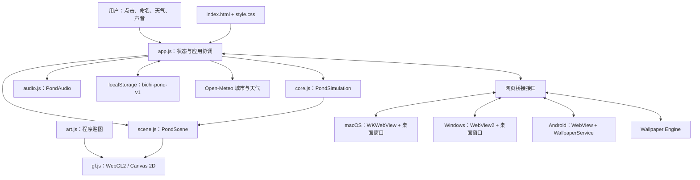
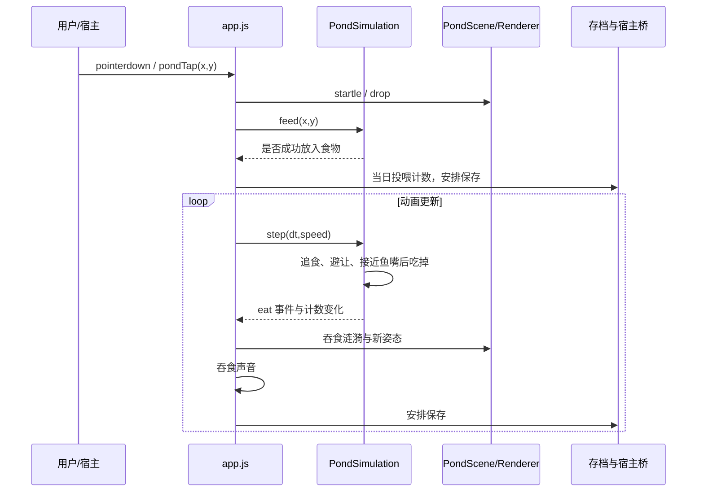

# 碧池观鱼（fishwallpaper）项目导读与初版设计文档

版本：0.1 · 阅读日期：2026-10-20  
仓库：[moli-xia/fishwallpaper](https://github.com/moli-xia/fishwallpaper)  
分析基线：`main`，提交 [`c2ceab2f82405344d5bdd4128e83433b49af4c6f`][commit]  
文档性质：基于现有代码重建设计说明，并提出下一阶段建议；不是原作者确认的产品规格。

## 1. 整体结论

**这是一个以原生 JavaScript 和 WebGL2 为共同引擎、用系统 WebView 封装到桌面和 Android 的交互式锦鲤池塘壁纸。** 它的核心价值是实时生成鱼类运动、水面光影和环境声音，并提供投喂、养鱼、天气及本地存档；它不是视频壁纸播放器，也没有仓库内的业务后端。网页可单独运行，macOS、Windows、Android 外壳负责桌面嵌入、输入转发、生命周期和窗口间同步。[入口][entry]、[应用协调][app]、[Windows 页面容器][winpage]、[Android 页面容器][androidweb]、[macOS 外壳][mac]

主要特点：

- **轻依赖**：网页没有 npm 第三方依赖；Node.js 用于开发服务、静态打包和测试。[package.json][pkg]
- **实时画面**：鱼的身体随脊柱弯曲；程序贴图配合多阶段 GPU 渲染，实现阴影、云影、折射、焦散和水波。[仿真][core]、[美术][art]、[渲染][gl]
- **共享内容、分平台集成**：三种原生外壳加载同一网页，不是三个独立重写的渲染器。[Windows 项目配置][winproj]、[macOS 构建][buildmac]、[Android 构建][buildandroid]
- **已有基础测试，但平台验证仍需补齐**：本次实际运行仓库四个测试文件，共 28 项通过；没有执行浏览器画面验证、原生编译或设备测试。
- **最值得优先解决的是存档同步和构建可复现性**：启动清洗会丢失 `rev`；Windows 打包脚本使用 macOS 的 `sips`；版本号分散且不一致。详见第 10 节。

### 1.1 证据等级

本文使用以下标记：

| 标记 | 含义 |
| --- | --- |
| **代码事实** | 从固定提交的实际源文件、配置或目录树确认 |
| **本次验证** | 本次在本地只读来源副本上运行并观察到的结果 |
| **仓库说明** | README、发布说明或代码注释中的作者陈述，未等同于本次实测 |
| **推断** | 由实现推导的架构判断或潜在影响 |
| **建议** | 初版设计提出的未来工作，目前不能视为已实现 |

未特别标为建议的模块、接口和运行流程，均描述当前代码。功能可从代码确认，不代表所有设备上的视觉效果、性能或兼容性已验证。

### 1.2 仓库快照

| 项目 | 读取结果 |
| --- | --- |
| 可见性、分支 | public，默认分支 `main`，未归档 |
| 创建时间 | 2026-09-25 |
| 基线提交时间 | 2026-10-08 03:26:57 UTC |
| 基线提交主题 | 合并 Windows WebView2 浏览器进程退出后的恢复改动 |
| GitHub 主要语言 | JavaScript |
| 读取时统计 | 54 stars、13 forks；仅作当日快照 |
| 最新 Release | `v1.2.1`，发布于 2026-09-25 |
| Release 标签提交 | `be1c764cd71b5a4dedbaa62de1fcf4423c163dee`，与本次 `main` 基线不同 |
| 版本配置 | `package.json` 为 1.0.0；原生构建相关配置为 1.2.1 |
| 许可证元数据 | GitHub 返回 `license: null`；本次完整树未发现 LICENSE 文件 |

来源：[仓库元数据][meta]、[基线提交][commit]、[v1.2.1 发布页][release]、[标签引用][tag]、[package.json][pkg]。元数据和发布状态会变化，源码链接已固定到分析提交。没有下载或核验 Release 二进制，不能认为发布包等同于当前 `main`。

## 2. 目标、功能与范围

### 2.1 产品目标

**推断**：项目希望提供一个低操作负担、可以长期留在桌面的观赏与轻互动环境。实现围绕三点展开：池塘看起来持续“活着”、用户能辨认和定制自己的鱼、壁纸不干扰系统桌面操作。

当前功能边界如下。[app.js][app]、[core.js][core]、[scene.js][scene]、[audio.js][audio]

| 功能域 | 当前实现 |
| --- | --- |
| 锦鲤与投喂 | 初始 24 尾锦鲤；普通投喂每次 9 粒；鱼食最多 180 粒、约 25 秒过期；追食、吞食计数、食量榜 |
| 锦鲤管理 | 七种花色、大小调整、随机花纹、手绘、命名、改名、确认后放生；最多 60 尾，UI 保留至少一尾 |
| 常驻生物 | 4 条青鲢独立于锦鲤存档和名额，不争抢鱼食；另有乌龟、螃蟹、蝴蝶、蜻蜓、萤火虫和花瓣 |
| 天气与夜景 | 晴、多云、雨、雪；雨雪强度；夜景与按日期估算的月相；天气参数平滑过渡 |
| 在线天气 | 搜索并明确选择城市；Open-Meteo 当前天气；15 分钟刷新；失败保留已有天气 |
| 声音 | Web Audio 实时合成水声、天气环境声、古琴/颂钵/风铃和互动音；默认关闭 |
| 显示与控制 | 30/60 帧目标、自动降分辨率、沉浸模式、键盘操作、移动布局、可见性与宿主暂停 |
| 数据 | 本地保存锦鲤外观、名字、进食记录、当天投喂次数和设置；同设备多页面同步 |
| 平台 | 浏览器、Wallpaper Engine 接口、macOS 桌面、Windows 桌面、Android 动态壁纸 |

**当前不包含的系统能力（基于已读取源码和完整目录树）**：账号登录、服务端数据库、跨设备云同步、在线素材市场、独立 iOS 动态壁纸外壳。天气是可选联网功能，基础池塘资源随程序分发。

### 2.2 非功能目标与实际边界

- **性能**：代码设置高画质 60 帧、节能 30 帧，并根据采样帧率降低像素密度；这是目标和调节逻辑，不是所有设备的性能保证。
- **资源控制**：渲染器限制主画布像素数量；纹理缓存、鱼数、食物数量和手绘笔触均有上限。
- **兼容性**：WebGL2 初始化失败可转 Canvas 2D；缺少浮点渲染目标时，WebGL2 可以继续工作，但不进行同样的水波仿真。
- **可恢复性**：包含加载失败提示、存档清洗、天气失败处理，以及部分原生渲染进程故障恢复。
- **节能**：后台或暂停时跳过仿真与绘制，并暂停声音；网页仍注册动画回调和时钟等定时器，不能仅凭代码宣称“绝对零耗电”。[app.js][app]、[gl.js][gl]

## 3. 目录与技术栈

完整递归目录树返回 `truncated: false`，共 67 个文件。下面省略图片的逐个文件名，保留架构相关路径。[固定提交目录][tree]

```text
fishwallpaper/
├── README.md
├── index.html                 页面入口、脚本顺序、基础界面
├── style.css                  布局、面板、移动端与壁纸样式
├── core.js                    鱼类仿真、姿态、存档清洗
├── art.js                     程序化贴图
├── gl.js                      WebGL2 与 Canvas 2D 渲染
├── scene.js                   场景生物、天气、浮层标注与绘制
├── audio.js                   声音合成
├── app.js                     应用状态、交互、天气、存档、主循环
├── package.json
├── project.json               Wallpaper Engine 属性定义
├── assets/
│   ├── ARTWORK.md             美术来源与生成提示词说明
│   ├── pond.png / pond.jpg    原始底图、运行底图
│   ├── pond-data.js           JPEG 的内嵌 data URL
│   └── app-icon.png / favicon.svg
├── scripts/
│   ├── serve.mjs / embed.mjs / build.mjs
│   ├── build-macos.sh / build-windows.sh / build-android.sh
│   └── publish-github.sh      发布脚本，本次未执行
├── native/
│   ├── macos/
│   │   ├── main.swift
│   │   └── Info.plist
│   └── windows/
│       ├── BichiPond.csproj / Program.cs / PondApp.cs
│       ├── PondWindows.cs / Desktop.cs / Native.cs
│       └── App.config / app.manifest / AppIcon.ico
├── android/
│   ├── AndroidManifest.xml
│   ├── java/com/bichi/koipond/
│   │   ├── MainActivity.java
│   │   ├── PondWeb.java
│   │   └── PondWallpaperService.java
│   └── res/                   图标、字符串、壁纸描述
├── tests/
│   ├── core.test.cjs / art.test.cjs
│   └── bed.test.cjs / scene.test.cjs
└── docs/
    ├── release-notes-1.2.0.md / release-notes-1.2.1.md
    └── screenshots/
```

| 层次 | 技术与依赖 |
| --- | --- |
| 网页 | HTML、CSS、原生 JavaScript；没有 React/Vue 等框架，也没有第三方 npm 包 |
| 图形 | WebGL2、GLSL 着色器、Canvas 2D、ImageData；自制精灵批处理与纹理图集 |
| 音频 | Web Audio API，程序合成声音 |
| 开发工具 | Node.js 内置 HTTP、文件系统、测试运行器和 VM 模块；未声明 `engines` |
| macOS | Swift、AppKit、WebKit/WKWebView、ServiceManagement；系统工具编译与打包 |
| Windows | C#、WinForms、.NET Framework 4.8；WebView2 包 `1.0.4191.47`；ReferenceAssemblies `1.0.3` |
| Android | Java、系统 WebView、WallpaperService、Presentation、VirtualDisplay；Android 10+ 使用 ImageReader/HardwareBuffer 帧桥接 |
| 外部服务 | Open-Meteo 城市搜索及天气接口；代码无需 API 密钥 |

依赖版本来自仓库配置，未做第三方依赖漏洞扫描或最新版本比较。[package.json][pkg]、[Windows 配置][winproj]、[Android 构建][buildandroid]、[macOS 源码][mac]

## 4. 架构设计：当前实现

### 4.1 总体结构



网页模块主要以全局命名空间连接：`PondCore`、`PondArt`、`PondGL`、`PondScene`、`PondAudio`。`index.html` 使用 `defer`，按 `core → art → gl → scene → audio → pond-data → app` 顺序加载。`core.js` 另外导出 CommonJS 接口，便于 Node 测试。[entry][entry]、[core][core]

**推断**：这是一种“应用协调器＋独立领域仿真＋场景和渲染分层”的轻量架构。维护门槛较低，但依赖加载顺序和共享可变对象；`app.js` 承担了较多职责。

### 4.2 模块职责与关键入口

| 模块 | 关键符号 | 输入 / 输出与职责 |
| --- | --- | --- |
| `core.js` | `PondSimulation.feed/step/swim/scare` | 接收时间、速度、目标位置；更新鱼、鱼食及进食事件 |
| `core.js` | `updateSpine`、`fishPose` | 将头部运动转为分段身体姿态，供渲染使用 |
| `core.js` | `sanitizeSave` | 清洗鱼数量、名字、大小、计数和手绘笔触等存档字段 |
| `art.js` | `fishLayers`、`fishSprite`、`miscSprites` | 根据花色、随机种子、物种和笔触生成图像；不负责业务计数 |
| `scene.js` | `PondScene.layout/update/draw/setLook` | 更新天气与其他生物，组织图层和绘制请求 |
| `scene.js` | `FLOATERS`、`floatMask` | 把底图中的荷叶、荷花、石头变成可单独处理的遮罩和浮层 |
| `gl.js` | `createRenderer/createGL/create2D` | 创建渲染器、管理 GPU 资源并执行合成；支持降级 |
| `audio.js` | `PondAudio.configure/setActive` | 应用音量、天气和音乐配置；合成、调度各声部 |
| `app.js` | `start/createPond/frame/feedAt` | 资源初始化、主循环、UI 与仿真连接 |
| `app.js` | `persist/applyExternalSave` | 本地保存、桥接广播、合并外部状态 |
| `app.js` | `searchCity/fetchWeather` | 搜索城市、获取天气、处理失败和过期响应 |

对应源码：[core][core]、[art][art]、[scene][scene]、[gl][gl]、[audio][audio]、[app][app]。

### 4.3 渲染结构

`gl.js` 的 `render()` 按以下顺序执行：

1. 注入水滴扰动，使用两个浮点纹理轮换计算波动状态；仿真累加器以每秒 90 次为目标，并限制单帧追赶量。
2. 生成较低分辨率的焦散纹理，即水光折射后形成的明亮纹路。
3. 生成云影纹理。
4. 绘制池底阴影。
5. 绘制底图与水下生物。
6. 计算水面坡度、波光，再合成折射、天空反射、月光和色调。
7. 绘制浮出水面的荷叶/花/石头，以及水面、空中、发光对象。

这不是完整的三维场景引擎：大量内容采用俯视贴图、分层合成和近似光照。**“2.5D 俯视渲染”是对实现的概括性推断。**[gl.js][gl]

高画质主画布上限约 360 万像素，节能约 160 万；水波网格每一维最多 900。Canvas 2D 降级保留鱼和其他精灵及简单圆环水波，但没有同等 GPU 折射、浮层和阴影效果，且底图不执行 WebGL 路径的竖屏旋转。[gl.js][gl]

### 4.4 平台外壳

| 平台 | 当前实现与边界 |
| --- | --- |
| macOS | `AppDelegate` 为每个显示器创建桌面层窗口与 WKWebView；透明点击层转发控件点击；面板打开时调整窗口层级和键盘交互；菜单栏控制暂停、天气和交互窗口；默认 WKWebsiteDataStore 保存网页数据 |
| Windows | `Program → PondApp`；每屏一个 `WallpaperForm`，另有 `InteractiveForm`；通过 Win32 的 Progman/WorkerW 桌面层嵌入；WebView2 将本地 `web/` 映射到 `https://pond.local`；全局鼠标钩子观察桌面轻点；定时检查遮挡、锁屏与部分进程故障 |
| Android | `MainActivity` 提供交互页面；`PondWeb` 统一 WebView 配置和跨页面广播；`PondWallpaperService.PondEngine` 用私有虚拟显示器上的 Presentation 承载网页，再输出到壁纸 Surface |
| Wallpaper Engine | `project.json` 定义属性；网页通过 `wallpaperPropertyListener` 接收参数、目标帧率和暂停通知 |

macOS 桌面页保留可点击控件；Windows、Android 使用 `?mode=wallpaper` 隐藏网页控件，另开交互页面设置。不能假定四种宿主的界面和输入方式完全相同。[mac][mac]、[winapp][winapp]、[winpage][winpage]、[desktop][desktop]、[androidservice][androidservice]、[project.json][project]

Android 10+ 默认路径：

```text
WebView / WebGL
  → Presentation
  → VirtualDisplay
  → ImageReader
  → HardwareBuffer / Bitmap
  → lockHardwareCanvas
  → 系统壁纸 Surface
```

Android 7–9 使用直接输出路径。代码中的“10 秒无帧则显示静态底图”检测仅在帧桥接路径生效；创建窗口的异常也有静态回退。它不是对所有系统和失败方式的完整保证。[PondWallpaperService.java][androidservice]

## 5. 关键运行流程

### 5.1 启动与每帧执行

1. HTML 顺序加载共享模块和底图内嵌数据。
2. `app.js` 从 `bichi-pond-v1` 读取存档，也兼容两个旧 key；经 `sanitizeSave` 和 `readSettings` 清洗。
3. 没有有效存档时创建初始锦鲤；独立生成青鲢群，初始化 `PondSimulation` 和 `PondAudio`。
4. `start()` 加载 `window.POND_IMAGE`，缺省使用 `assets/pond.jpg`。
5. `createPond()` 创建渲染器、场景和底图遮罩，按尺寸布局，上传鱼类贴图。
6. `frame()` 按目标帧率执行：仿真 → 进食事件 → 天气和生物更新 → 雷声事件 → 场景绘制 → 渲染器合成 → 名字和预览。
7. 暂停或隐藏时跳过主要更新；恢复时重置时间基线，避免过大的时间步长。

`dt` 最大限制为 0.05 秒；高画质像素密度最多为 3 倍，并可分两级降到初始值的 0.72、0.5，最终不低于 1 倍。[app.js][app]

### 5.2 典型流程：点击投喂



`feedAt()` 先制造扰动，再调用 `feed()`；`swim()` 根据鱼嘴距离和反应时间选食物，吃到后置 `eaten=true`，增加该鱼和本次仿真的计数。下一步清理食物，避免同一粒重复记账。青鲢跳过食物搜索。关闭投喂时，点击走 `scare()` 逃离逻辑。[app.js][app]、[core.js][core]

### 5.3 天气获取

1. `searchCity()` 请求 `geocoding-api.open-meteo.com/v1/search`，最多返回 5 个结果。
2. 用户点击某个结果，保存城市名称与经纬度，开启自动天气。
3. `fetchWeather()` 请求 `api.open-meteo.com/v1/forecast` 的当前温度、天气码、风速、降水和降雪。
4. `weatherFromCode()` 映射为四种天气；降水/降雪量换算为视觉强度。
5. 请求设 12 秒超时，并用请求序号防止旧响应覆盖新选择；失败保留旧天气并提示。
6. 每 15 分钟再次尝试刷新。

代码获取了风速，但当前 `fetchWeather()` 未将它直接写入风力控制；不应描述为完整复刻当地所有气象参数。城市搜索发送名称，天气查询发送所选城市坐标，未发现 GPS 定位请求。[app.js][app]

## 6. 数据与桥接接口

### 6.1 持久化模型

逻辑结构如下，省略了具体样本值：

```text
Save
├── rev                       最近一次用户编辑时间戳
├── fish[]                    最多 60 尾锦鲤
│   ├── id, name
│   ├── palette, size, seed
│   ├── eaten
│   └── marks[]               {x, y, r, color}，最多 400 个笔触
├── settings                  天气、城市、画质、声音、生物开关等
└── daily                     {date, count}，当日投喂次数
```

鱼的位置、速度、转向、脊柱、食物队列、青鲢和其他场景生物不写入 `persist()` 的存档。**因此重启保留用户养成数据，但不会从完全相同的游动瞬间继续。**[app.js][app]、[core.js][core]

### 6.2 同步规则

- `scheduleSave()` 使用 500 毫秒防抖。
- 名字、鱼群构成、外观或设置的编辑改变签名时，`persist()` 把 `rev` 更新为 `Date.now()`。
- 外部存档的 `rev` 更新时，接收它的设置和鱼群；对于同一条鱼，进食计数取两者较大值。
- 当日投喂次数也取最大值，而非相加。
- 浏览器同源标签页通过 `storage` 事件同步；原生外壳把页面消息转发给其他页面。

**推断**：这是多窗口状态同步，不是严格的分布式事件账本。多个窗口同时投喂时，“取最大值”可能漏计独立发生的增量；毫秒时间戳相同或系统时间回拨也没有明确的冲突裁决。应先确认产品希望同步的是“同一个池塘的状态”还是“所有窗口的事件总和”。[app.js][app]

### 6.3 网页与宿主契约

| 接口 | 方向 | 当前用途 |
| --- | --- | --- |
| `pondControl.set(options)` | 宿主 → 网页 | 天气、夜景、声音设置；触发保存 |
| `pondControl.pause(boolean)` | 宿主 → 网页 | 暂停/恢复主要更新和音频 |
| `pondControl.state()` | 宿主 → 网页 | 读取天气、声音及暂停状态 |
| `pondTap(x,y)` | 宿主 → 网页 | 以 CSS 像素传入壁纸点击位置 |
| `__pondSync(json)` | 宿主/页面 → 网页 | 接收另一个页面的存档 |
| `webkit.messageHandlers.pond.postMessage(json)` | 网页 → macOS | 转发保存数据 |
| `chrome.webview.postMessage(json)` | 网页 → Windows | 转发保存数据 |
| `PondHost.postMessage(json)` | 网页 → Android | 转发保存数据 |
| `PondHost.setWallpaper/isWallpaperActive/wallpaperStatus` | 网页 → Android | 打开壁纸选择、查询状态 |
| `wallpaperPropertyListener` | Wallpaper Engine → 网页 | 自定义属性、帧率和暂停 |

接口目前以全局函数、对象和 JSON 字符串表达，没有单独的协议版本或类型定义文件。[app][app]、[androidweb][androidweb]、[winpage][winpage]、[mac][mac]

## 7. 获取、运行与构建

下面是供读者执行的步骤；本次没有安装原生程序、设置系统壁纸或执行发布脚本。

### 7.1 最短体验路径：网页

**仓库支持的步骤**：

```sh
git clone https://github.com/moli-xia/fishwallpaper.git
cd fishwallpaper
npm run dev
```

打开 [本地页面](http://localhost:5173)。也可以运行 `node scripts/serve.mjs`，或直接打开 `index.html`。不需要 `npm install`；`package.json` 没有 dependencies/devDependencies。[README][readme]、[package.json][pkg]

**环境说明**：仓库未声明最低 Node 版本；本次验证使用 Node.js 24.16.0。浏览器需要支持代码使用的现代 JavaScript 和浏览器 API；WebGL2 是完整画面的首选路径，声音依赖 Web Audio。

开发服务只监听 `127.0.0.1`。PowerShell 改端口的对应写法：

```powershell
$env:PORT = '8080'
npm run dev
```

`file://`、localhost、不同端口和不同宿主的存储来源不同；不要期待它们自动共享同一份鱼群。[开发服务][serve]、[README][readme]

### 7.2 测试与网页构建

```sh
npm test
npm run build
```

- `npm test` 调用 Node 内置测试运行器。
- `npm run build` 先运行 `embed.mjs`，由 `assets/pond.jpg` 重生成 `pond-data.js`，再把明确列举的静态文件复制到 `dist/`。
- 这不是打包器压缩编译：未使用 Vite/Webpack，没有 JavaScript 转译过程。
- 构建只替换列举的网页输出，不清空 `dist/` 的所有其他平台产物。
- Wallpaper Engine 可导入 `dist/index.html`，属性定义在 `project.json`。

来源：[build.mjs][build]、[embed.mjs][embed]、[project.json][project]。

**注意**：三个原生构建入口不会统一先调用 `embed.mjs`。修改底图后，应先运行 `npm run build` 或 `node scripts/embed.mjs`，避免原生包携带旧的内嵌图片。

### 7.3 macOS 构建

仓库入口：

```sh
./scripts/build-macos.sh
```

脚本实际需要 macOS、zsh、可用的 `swiftc` 和 `sips/iconutil/codesign/hdiutil` 等系统工具；最低编译目标为 macOS 12。先编译 arm64，再尝试 x86_64；成功则合成通用二进制，否则仅保留 arm64。[build-macos.sh][buildmac]

输出为 `dist/碧池观鱼.app` 和 `dist/碧池观鱼-1.2.1.dmg`。脚本使用 ad-hoc 签名。当前 Release 说明标的是 Apple 芯片版，不能仅凭 README 下载表认定该 DMG 包含 Intel 架构。[发布页][release]

### 7.4 Windows 构建与运行

仓库入口：

```sh
./scripts/build-windows.sh
```

**代码事实**：该脚本要求 zsh、.NET SDK、Python 3、zip，并调用 macOS 的 `sips` 生成图标。虽然注释称可在 macOS/Linux 构建，完整脚本不能据此视为 Linux 或原生 Windows 上可直接运行。[build-windows.sh][buildwin]

项目本身目标是 `net48`，依赖 WebView2；脚本说明构建工具使用 .NET SDK 8+。输出目录为 `build/windows/BichiPond`，随后压缩到 `dist/碧池观鱼-Windows-1.2.1.zip`。

**推导出的 Windows 开发入口，未在本次执行**：

```powershell
dotnet publish native/windows/BichiPond.csproj -c Release -o build/windows/BichiPond
```

仓库已有 `AppIcon.ico`，项目配置负责复制 `web/` 文件；该命令绕开图标生成和 ZIP 打包步骤。是否在目标机器完整成功仍需验证，不应称为已经验证的跨平台打包方案。[BichiPond.csproj][winproj]

运行时解压完整目录并启动 `BichiPond.exe`；需要 .NET Framework 4.8 和 WebView2 Runtime。应用会检测缺失的 WebView2 并提供下载入口，不能假定每台 Windows 10 已具备所有前提。数据目录为 `%LOCALAPPDATA%\BichiPond\WebView2`，错误日志为 `%LOCALAPPDATA%\BichiPond\error.log`。[PondApp.cs][winapp]

### 7.5 Android 构建

```sh
./scripts/build-android.sh
```

这不是 Gradle 项目。脚本直接调用 `aapt2 → javac → d8 → zipalign → apksigner`：

- 默认工具目录 `~/android-build`，可用 `ANDROID_BUILD` 指定。
- JDK 路径写为 `jdk/Contents/Home`，脚本头部工具包示例针对 macOS。
- JDK 17，Java 编译目标 `--release 11`。
- 编译使用 Android 34 平台；minSdk 24、targetSdk 34。
- 构建版本 1.2.1，versionCode 4。
- 输出 `android/build/碧池观鱼.apk`，再复制到 `dist/碧池观鱼.apk`。

脚本尝试保留已有签名密钥，使后续 APK 可沿用身份。它不是开箱即用的 Android Studio 工程，其他系统需适配路径与工具。[build-android.sh][buildandroid]

## 8. 本次验证与覆盖边界

### 8.1 实际执行

在仅包含通过 GitHub 插件取得的文本源文件副本中，使用 Windows 上 Node.js 24.16.0 执行了全部四个测试文件。

普通 `node --test` 首次因本地执行环境禁止创建测试子进程而报 `spawn EPERM`，不是测试断言失败。改用同进程隔离模式后：

```sh
node --test --test-isolation=none tests/art.test.cjs tests/bed.test.cjs tests/core.test.cjs tests/scene.test.cjs
```

**本次验证：28 项通过，0 项失败，0 项跳过。**

| 测试文件 | 主要覆盖 | 数量 |
| --- | --- | --- |
| `core.test.cjs` | 吞食单次记账、边界稳定、食物上限与过期、天气映射、异常存档、笔触、姿态、受惊、避障、青鲢 | 13 |
| `art.test.cjs` | 鱼身形状、鳞片纹理、纯红像素、青鲢体形与颜色 | 4 |
| `bed.test.cjs` | 横竖屏底图映射、坐标逆变换、荷花可见范围 | 7 |
| `scene.test.cjs` | 天气参数一致性、云量、雨滴浮层扰动、雷声事件 | 4 |

源码：[tests 目录][tests]。

### 8.2 不能由这些结果推出的结论

- 美术测试使用 ImageData 替身；场景测试使用简化渲染器。它们不覆盖真实 GPU 着色器、最终屏幕像素或驱动兼容性。
- 未测试浏览器 UI、真实天气请求、声音播放、跨窗口存档竞争。
- 未执行 `npm run build`，未下载完整图片资源；也未编译 macOS/Windows/Android。
- 未安装 Release 包，未验证签名、包内架构、耗电、内存、多屏或 OEM 桌面表现。
- README 声称做过 Android 14/15/16 模拟器验证，并明确 Windows/Wallpaper Engine 缺少当时的宿主实测；这些是仓库说明，不是本次测试结果。[README][readme]

## 9. 初版后续设计建议

以下全部为**建议**，未修改源码。

### 9.1 保留共同网页引擎，缩小协调层职责

不必为每个平台重写画面。可逐步从 `app.js` 提取：

| 建议模块 | 职责与收益 |
| --- | --- |
| `SaveStore` | 定义存档 schema、迁移、清洗、写入和恢复；解决 `rev` 丢失并统一校验 |
| `SyncCoordinator` | 明确冲突策略，处理窗口身份、版本和广播；为并发同步建立可测试入口 |
| `WeatherClient` | 封装请求、超时、缓存和失败状态，独立测试过期响应 |
| `HostAdapter` | 将 macOS/Windows/Android/Wallpaper Engine 差异收敛到适配接口 |
| `AppController` | 仅协调 UI、生命周期、场景和领域对象 |

这些可先以现有脚本方式实现，无需立即引入框架或大规模重构。未来若改为 ES Modules，应先确认 `file://` 和各 WebView 的资源加载策略。

### 9.2 数据与同步规格

建议新增明确的 `schemaVersion`，保留经过校验的 `rev`，并增加稳定的 `clientId` 作为同一时刻冲突的裁决条件。

需要先做一个产品选择：

- **状态镜像**：各窗口展示同一份集合，以一个宿主协调器为权威，其他窗口提交编辑请求。
- **独立互动汇总**：每个投喂/吞食增量带唯一事件标识，去重后累计，避免最大值合并漏计。

无论选择哪一种，都应定义改名与放生竞争、窗口重载、离线/休眠恢复的行为。保留 JSON 导出/导入可作为下一阶段数据备份能力。

### 9.3 性能与降级规格

建议把高画质、节能和 2D 三种表现分别写清楚，避免把降级描述成视觉等价。新增可查看的诊断信息：渲染类型、真实帧率、画布分辨率、降级原因和最近一次宿主错误。

多屏下各页面独立创建音频引擎；应确认是否需要“仅一个页面发声”，防止重叠环境音和额外耗电。新增物种时还应同时调整 `MAX_FISH` 和纹理布局：当前渲染容量 66，60 尾锦鲤加 4 条青鲢只剩 2 个余量。[gl.js][gl]

### 9.4 建议验收条件

| 范围 | 建议验收标准 |
| --- | --- |
| 存档 | 重载后字段与版本保持；损坏数据能恢复或提示；迁移不会静默丢鱼 |
| 同步 | 两窗口同时改名、投喂、删除；关闭再打开；能得到预先定义的确定结果 |
| 渲染 | WebGL2、无浮点目标、Canvas 2D 三条路径均可启动；上下文丢失后能恢复 |
| Windows | Win10/Win11、多屏与混合 DPI、锁屏、Explorer 重启、WebView2 进程终止 |
| Android | 至少覆盖直接/桥接两路径和多家实际设备；旋转、锁屏、无帧、进程回收均有可解释结果 |
| 网络 | 超时、失败、返回字段缺失、快速换城市时不覆盖新选择 |
| 性能 | 记录固定设备、分辨率、天气和鱼数下的帧率/内存/耗电，建立基线后再确定预算 |
| 发布 | 同一版本号贯穿配置、标签、文件名；自动运行单测和各平台构建；发布包记录来源提交 |

## 10. 风险、问题与待确认项

优先级表示建议处理顺序，不是完整安全审计的严重性评级。

| 优先级 | 发现与证据 | 影响 / 建议 |
| --- | --- | --- |
| 高 | **本次验证**：`sanitizeSave({rev:123,...})` 只返回 `fish/settings/daily`；`app.js` 启动后从 `saved.rev` 初始化，实际得到 0。[core.js L165–171][sanitizer]、[app.js L22–60][savestart] | **推断**：重载页失去原编辑版本，接收旧广播时可能错误判断新旧。先保留并校验 `rev`，补重载＋旧消息测试 |
| 高 | **代码事实**：进食和投喂计数按最大值合并，编辑按整份集合和时间戳覆盖。[app.js][app] | 并发增量可能漏计；同毫秒冲突没有额外裁决。确认同步语义后选择协调器或去重事件 |
| 高 | **代码事实**：Windows 脚本使用 `sips`、zsh；Android 使用定制 JDK/SDK 布局。[Windows 构建][buildwin]、[Android 构建][buildandroid] | 构建者换机器后可能无法复现。补环境清单、可用工具检测和按系统分开的入口 |
| 中 | **代码事实**：`package.json` 为 1.0.0，原生配置为 1.2.1；Release 标签与 `main` 不是同一提交。[pkg][pkg]、[release][release]、[tag][tag] | 文档、发布包和当前源码易混淆。统一版本来源并记录包对应 SHA |
| 中 | **代码事实**：Windows 桌面集成使用代码自身标注为未公开的 `0x052C` 消息及 WorkerW 结构。[Desktop.cs][desktop] | 系统版本变动可能导致嵌入失效，需要真实系统回归；现有不同桌面结构分支并不构成未来兼容保证 |
| 中 | **代码事实**：`OnProcessFailed()` 仅对 `BrowserProcessExited` 发起重建；`BuildWallpapers()` 重建壁纸窗口。[PondApp.cs][winapp] | 渲染进程故障和交互窗口恢复仍需场景验证，不宜概括为所有 WebView2 崩溃都能恢复 |
| 中 | **代码事实**：Android 的 10 秒无帧检测附带 `bridge` 条件，Android 7–9 走直接路径。[PondWallpaperService.java][androidservice] | 为旧系统及厂商差异建立兼容矩阵，确认是否扩展超时回退 |
| 中 | **代码事实**：Android 签名脚本内置固定 keystore 密码，密钥保存在构建目录并在重建时暂存。[build-android.sh][buildandroid] | 正式发布宜独立管理密钥、备份和构建凭据；本次未读取任何实际密钥 |
| 中 | **代码事实**：`FLOATERS` 是针对固定底图的硬编码坐标；原生脚本直接复制 `pond-data.js`。[scene][scene]、[embed][embed] | 换图时需要同步标注并重新生成内嵌图；建议把标注外置成可校验资源 |
| 中 | **代码事实**：完整树未发现 `.github/workflows`；测试主要覆盖纯逻辑。[tree][tree]、[tests][tests] | 缺少仓库内 CI 定义和渲染/宿主集成回归；不代表仓库外绝无自动化 |
| 待确认 | **元数据事实**：`license: null`，未发现 LICENSE；ARTWORK.md 记录底图为生成素材。[meta][meta]、[artwork][artwork] | 请作者明确代码与素材许可；本文不推定任何授权条款 |
| 待确认 | README 提醒天气服务商业使用需核查现行条件。[README][readme] | 商业化前另行确认服务方案；本次未审查外部服务条款 |

补充代码质量观察：已有边界限制、存档清洗、天气超时和错误提示是积极基础；但多处 `catch {}` 会吞掉桥接或存储相关诊断，且 UI 模板和处理逻辑密集写在长行中，后续拆模块会有助于定位问题。[app.js][app]

## 11. 推荐阅读顺序

先走“页面 → 状态 → 仿真 → 场景 → 渲染”，再选择你关心的平台，通常比先读大量着色器更容易建立整体认识。

| 顺序 | 文件 / 入口 | 阅读目的 |
| --- | --- | --- |
| 1 | [README.md][readme] | 认识产品与作者声称的验证范围，保留与代码核对的意识 |
| 2 | [index.html][entry] | 理解脚本依赖顺序、画布和界面组成 |
| 3 | [app.js][app]：`start/frame/feedAt` | 跟通从启动到投喂的一次完整链路 |
| 4 | [core.js][core]：`PondSimulation` | 理解追食、避让、运动与吞食计数 |
| 5 | [core.js][core]：`sanitizeSave`，回看 app 的保存函数 | 理解持久化字段与同步边界 |
| 6 | [scene.js][scene]：`PondScene`、`FLOATERS` | 理解底图如何和动态内容组合 |
| 7 | [art.js][art]：`fishLayers/fishSprite` | 理解鱼的外观生成和手绘纹理 |
| 8 | [gl.js][gl]：`createRenderer/render` | 理解渲染阶段，之后再读各段 GLSL |
| 9 | [audio.js][audio]：`configure/setActive/schedule` | 理解合成音频如何跟随场景 |
| 10 | [PondApp.cs][winapp] 或 [main.swift][mac] 或 [PondWallpaperService.java][androidservice] | 选择目标平台理解系统嵌入和生命周期 |

读到第 4 步后，可运行 [core.test.cjs][coretests] 帮助理解行为约束；需要改部署与打包时，再读 [package.json][pkg] 和 [scripts][scripts]。

最值得继续深入的三个问题：

1. 多窗口究竟代表同一个权威池塘，还是多个互动入口？计数与删除冲突应怎样定义？
2. 准备优先保证哪些设备、桌面系统和帧率？完整画面与降级画面的最低验收标准是什么？
3. 是否计划商业发布和长期维护？如果是，应先明确许可、签名、版本来源和自动化发布流程。

## 12. 阅读范围与未访问内容

### 已读取与使用

- 通过已连接 GitHub 插件读取仓库元数据、`main` 引用、固定提交信息、完整递归树、Release 元数据和标签引用。
- 取得 44 个文本文件的完整内容，并在本地保存只读来源副本；重点阅读六个网页模块、入口、构建脚本、平台关键源码及四个测试文件，其他配置和辅助文件按相关字段检查。
- 分析依据是当前固定提交，而非引用对话里对项目的描述。
- 没有修改 GitHub 文件、创建分支、提交、评论、PR 或发布任何内容；本地只有分析副本和本 Markdown 产物。

### 未读取或未验证

| 范围 | 状态 / 原因 |
| --- | --- |
| 44 个选定文本文件 | 全部通过插件成功取得，没有文件级访问失败 |
| `assets/pond-data.js` | 约 897 KB 的生成图片数据，未读取其完整内容；生成方式由 `embed.mjs` 确认 |
| 22 个 PNG/JPG/ICO 文件 | 只取得目录树元数据，未下载或目视检查；文本读取接口不提供二进制图像检查 |
| Release APK/DMG/ZIP 与 SHA256SUMS 文件内容 | 只查看发布清单，没有下载、执行或校验 |
| Issue/PR 讨论与其他分支 | 未系统阅读；仅基线提交信息显示合并主题，不据此评价全部维护历史 |
| 外部 API、操作系统运行时 | 未发起天气实测或安装原生程序，未核查外部条款 |

因此，本报告适合作为理解项目、选择阅读路径和安排后续开发的初版设计依据；平台性能和发布可用性仍以目标环境验收为准。

---

## 源码证据索引

以下源码链接固定到同一提交。引用中的“事实”来自文件内容，“建议”和风险影响仍按正文标注区分。

- [仓库与元数据][meta]；[固定提交][commit]；[完整目录][tree]；[v1.2.1 发布][release]。
- 页面与核心：[index.html][entry]、[app.js][app]、[core.js][core]、[art.js][art]、[scene.js][scene]、[gl.js][gl]、[audio.js][audio]。
- 构建与配置：[package.json][pkg]、[project.json][project]、[scripts][scripts]、[Windows 项目配置][winproj]。
- 原生：[macOS main.swift][mac]、[Windows PondApp.cs][winapp]、[Windows PondWindows.cs][winpage]、[Windows Desktop.cs][desktop]、[Android PondWeb.java][androidweb]、[Android PondWallpaperService.java][androidservice]。
- 验证：[tests 目录][tests]；素材说明：[ARTWORK.md][artwork]。

[meta]: https://api.github.com/repos/moli-xia/fishwallpaper
[commit]: https://github.com/moli-xia/fishwallpaper/commit/c2ceab2f82405344d5bdd4128e83433b49af4c6f
[tree]: https://github.com/moli-xia/fishwallpaper/tree/c2ceab2f82405344d5bdd4128e83433b49af4c6f
[release]: https://github.com/moli-xia/fishwallpaper/releases/tag/v1.2.1
[tag]: https://api.github.com/repos/moli-xia/fishwallpaper/git/ref/tags/v1.2.1
[readme]: https://github.com/moli-xia/fishwallpaper/blob/c2ceab2f82405344d5bdd4128e83433b49af4c6f/README.md
[entry]: https://github.com/moli-xia/fishwallpaper/blob/c2ceab2f82405344d5bdd4128e83433b49af4c6f/index.html
[app]: https://github.com/moli-xia/fishwallpaper/blob/c2ceab2f82405344d5bdd4128e83433b49af4c6f/app.js
[core]: https://github.com/moli-xia/fishwallpaper/blob/c2ceab2f82405344d5bdd4128e83433b49af4c6f/core.js
[art]: https://github.com/moli-xia/fishwallpaper/blob/c2ceab2f82405344d5bdd4128e83433b49af4c6f/art.js
[scene]: https://github.com/moli-xia/fishwallpaper/blob/c2ceab2f82405344d5bdd4128e83433b49af4c6f/scene.js
[gl]: https://github.com/moli-xia/fishwallpaper/blob/c2ceab2f82405344d5bdd4128e83433b49af4c6f/gl.js
[audio]: https://github.com/moli-xia/fishwallpaper/blob/c2ceab2f82405344d5bdd4128e83433b49af4c6f/audio.js
[pkg]: https://github.com/moli-xia/fishwallpaper/blob/c2ceab2f82405344d5bdd4128e83433b49af4c6f/package.json
[project]: https://github.com/moli-xia/fishwallpaper/blob/c2ceab2f82405344d5bdd4128e83433b49af4c6f/project.json
[scripts]: https://github.com/moli-xia/fishwallpaper/tree/c2ceab2f82405344d5bdd4128e83433b49af4c6f/scripts
[serve]: https://github.com/moli-xia/fishwallpaper/blob/c2ceab2f82405344d5bdd4128e83433b49af4c6f/scripts/serve.mjs
[build]: https://github.com/moli-xia/fishwallpaper/blob/c2ceab2f82405344d5bdd4128e83433b49af4c6f/scripts/build.mjs
[embed]: https://github.com/moli-xia/fishwallpaper/blob/c2ceab2f82405344d5bdd4128e83433b49af4c6f/scripts/embed.mjs
[buildmac]: https://github.com/moli-xia/fishwallpaper/blob/c2ceab2f82405344d5bdd4128e83433b49af4c6f/scripts/build-macos.sh
[buildwin]: https://github.com/moli-xia/fishwallpaper/blob/c2ceab2f82405344d5bdd4128e83433b49af4c6f/scripts/build-windows.sh
[buildandroid]: https://github.com/moli-xia/fishwallpaper/blob/c2ceab2f82405344d5bdd4128e83433b49af4c6f/scripts/build-android.sh
[winproj]: https://github.com/moli-xia/fishwallpaper/blob/c2ceab2f82405344d5bdd4128e83433b49af4c6f/native/windows/BichiPond.csproj
[winapp]: https://github.com/moli-xia/fishwallpaper/blob/c2ceab2f82405344d5bdd4128e83433b49af4c6f/native/windows/PondApp.cs
[winpage]: https://github.com/moli-xia/fishwallpaper/blob/c2ceab2f82405344d5bdd4128e83433b49af4c6f/native/windows/PondWindows.cs
[desktop]: https://github.com/moli-xia/fishwallpaper/blob/c2ceab2f82405344d5bdd4128e83433b49af4c6f/native/windows/Desktop.cs
[mac]: https://github.com/moli-xia/fishwallpaper/blob/c2ceab2f82405344d5bdd4128e83433b49af4c6f/native/macos/main.swift
[androidweb]: https://github.com/moli-xia/fishwallpaper/blob/c2ceab2f82405344d5bdd4128e83433b49af4c6f/android/java/com/bichi/koipond/PondWeb.java
[androidservice]: https://github.com/moli-xia/fishwallpaper/blob/c2ceab2f82405344d5bdd4128e83433b49af4c6f/android/java/com/bichi/koipond/PondWallpaperService.java
[tests]: https://github.com/moli-xia/fishwallpaper/tree/c2ceab2f82405344d5bdd4128e83433b49af4c6f/tests
[coretests]: https://github.com/moli-xia/fishwallpaper/blob/c2ceab2f82405344d5bdd4128e83433b49af4c6f/tests/core.test.cjs
[artwork]: https://github.com/moli-xia/fishwallpaper/blob/c2ceab2f82405344d5bdd4128e83433b49af4c6f/assets/ARTWORK.md
[sanitizer]: https://github.com/moli-xia/fishwallpaper/blob/c2ceab2f82405344d5bdd4128e83433b49af4c6f/core.js#L165-L171
[savestart]: https://github.com/moli-xia/fishwallpaper/blob/c2ceab2f82405344d5bdd4128e83433b49af4c6f/app.js#L22-L60
